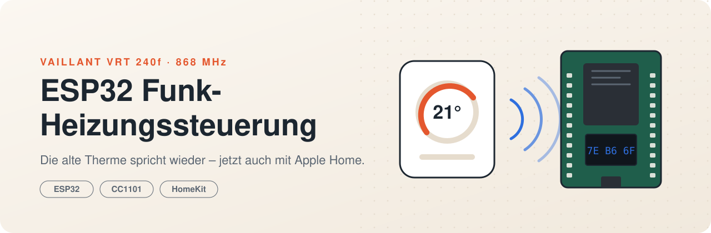
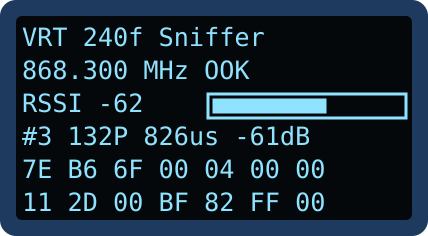
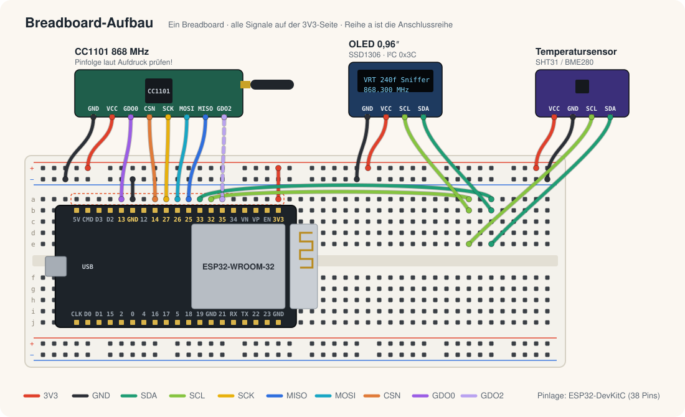
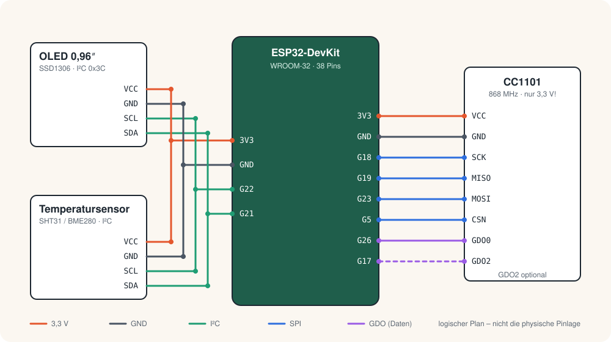
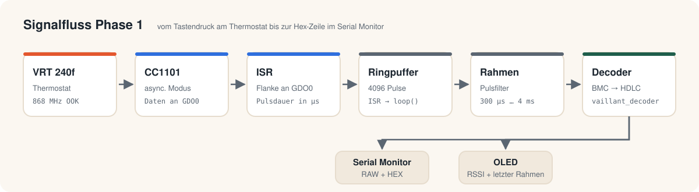

<picture>
  <source media="(prefers-color-scheme: dark)" srcset="docs/assets/hero-dark.svg">
  
</picture>

<p align="center">
  <a href="https://github.com/lindekai/ESP32-Funk-Heizungssteuerung/actions/workflows/ci.yml"></a>
  
  
  
  
  <a href="LICENSE"></a>
</p>

<p align="center">
  <a href="docs/aufbau.md"><b>Aufbau</b></a> ·
  <a href="docs/firmware.md"><b>Firmware</b></a> ·
  <a href="docs/protokoll.md"><b>Protokoll</b></a> ·
  <a href="#roadmap"><b>Roadmap</b></a> ·
  <a href="CONTRIBUTING.md"><b>Mitmachen</b></a>
</p>

Eine Vaillant-Therme von 1994 mit nachgerüstetem Funkthermostat VRT 240f bekommt einen smarten Gesprächspartner. Ein ESP32 mit CC1101-Funkmodul lernt das 868-MHz-Protokoll des Thermostats, misst selbst die Raumtemperatur und schaltet die Heizung. Am Ende erscheint das Gerät als Thermostat in Apple Home – ohne Cloud, ohne MQTT.

> [!NOTE]
> **Status: Phase 1 – Sniffer.** Firmware und Decoder sind fertig und getestet. Der Mitschnitt am echten VRT 240f folgt, sobald das CC1101-Modul da ist.

<!-- Foto/Rendering des fertigen Geräts folgt mit Phase 6 (Gehäuse) -->

## Features

<table>
<tr>
<td width="55%" valign="top">

- 📡 **Sniffer:** CC1101 im asynchronen OOK-Modus, Pulsmessung per Interrupt, Ausgabe roh und dekodiert
- 🧩 **Decoder:** Differential Manchester (BMC) und HDLC-Rahmen mit Bit-Stuffing nach dem Vorbild des VRT-340f-Decodings, mit Unit-Tests auf dem Rechner
- 🎛️ **Live-Tuning:** Frequenz, Bandbreite und Grundpuls per Serial-Befehl, ohne neu zu flashen
- 🖥️ **OLED-Anzeige:** Live-RSSI und letzter Rahmen auf einen Blick
- 🛠️ *geplant:* Senden „Heizung an/aus“, Regelung mit Hysterese, HomeKit, 3D-gedrucktes Gehäuse

</td>
<td width="45%" valign="top">

</td>
</tr>
</table>

## Hardware

| Bauteil | Details | Bezug |
| --- | --- | --- |
| ESP32-DevKit | ESP32-WROOM-32, 38 Pins, Micro-USB | z. B. AZ-Delivery, Berrybase, Amazon |
| CC1101-Modul | **868-MHz-Variante** mit Antenne, 2,54-mm-Raster | z. B. Amazon, eBay, AliExpress („CC1101 868MHz“) |
| OLED 0,96″ | 128×64, SSD1306, I²C (0x3C) | z. B. AZ-Delivery, Berrybase |
| Temperatursensor | SHT31 oder BME280, I²C (noch offen) | z. B. Adafruit, Berrybase |
| Netzteil | USB, 5 V / ≥ 1 A | – |
| Aufbau | 1 Breadboard (830 Punkte), Dupont-Kabel | – |

> [!WARNING]
> Der CC1101 verträgt nur **3,3 V**. Niemals an 5 V anschließen.

## Aufbau

<picture>
  <source media="(prefers-color-scheme: dark)" srcset="docs/assets/breadboard-dark.svg">
  
</picture>

<details>
<summary><b>Schaltplan und Pin-Tabelle</b></summary>
<br>

<picture>
  <source media="(prefers-color-scheme: dark)" srcset="docs/assets/schaltplan-dark.svg">
  
</picture>

| Bauteil | Pin | ESP32 |
| --- | --- | --- |
| CC1101 | VCC / GND | 3V3 / GND |
| CC1101 | GDO0 / CSN / SCK | G13 / G14 / G27 |
| CC1101 | MOSI / MISO / GDO2 (optional) | G26 / G25 / G35 |
| OLED + Sensor | VCC / GND | 3V3 / GND |
| OLED + Sensor | SCL / SDA | G32 / G33 |

</details>

Schritt-für-Schritt-Anleitung, Stückliste und Fehlersuche: **[docs/aufbau.md](docs/aufbau.md)**

## Schnellstart

Voraussetzung: [Arduino IDE 2](https://www.arduino.cc/en/software).

1. **ESP32-Boardpaket:** *Werkzeuge → Board → Boardverwalter*, nach „esp32“ suchen und **esp32 von Espressif Systems** installieren.
2. **Bibliotheken:** *Werkzeuge → Bibliotheken verwalten*, **SmartRC-CC1101-Driver-Lib** und **U8g2** installieren.
3. **Sketch öffnen:** [`firmware/vrt240f_sniffer/vrt240f_sniffer.ino`](firmware/vrt240f_sniffer/vrt240f_sniffer.ino)
4. **Board wählen:** *Werkzeuge → Board → esp32 → ESP32 Dev Module*, dazu den passenden Port.
5. **Hochladen** (→) und den **seriellen Monitor** mit **115200 Baud** öffnen.

> [!TIP]
> Bricht der Upload mit „Failed to connect“ ab: beim Erscheinen von „Connecting…“ die **BOOT**-Taste am DevKit kurz gedrückt halten.

Dann am VRT 240f die Solltemperatur deutlich über bzw. unter die Raumtemperatur drehen, damit er sendet. Im Serial Monitor erscheint pro Funkrahmen:

```
# Rahmen 3 | 132 Pulse | Grundpuls 826 us | RSSI -61 dBm | Halbbit-Fehler 0
RAW: +1650 -825 +825 -1650 +1650 -1650 ...
HEX (Phase 0): 7E B6 6F 00 04 00 00 11 2D 00 BF 82 FF 00
```

Befehle wie `f 868.28` (Frequenz) oder `bw 200` (Bandbreite) stellen den Empfänger live um. Die Befehle tippst du oben in die Eingabezeile des seriellen Monitors. Alle Befehle und die Funktionsweise: **[docs/firmware.md](docs/firmware.md)**. Mitschnitte schreibt [`tools/capture.py`](tools/capture.py) in eine Datei.

*WLAN-Einrichtung und Kopplung mit Apple Home folgen mit Phase 5.*

## So funktioniert's

<picture>
  <source media="(prefers-color-scheme: dark)" srcset="docs/assets/architektur-dark.svg">
  
</picture>

## Roadmap

- [x] Projektgerüst, Schaltplan, Breadboard-Plan, CI (Arduino CLI)
- [x] **Phase 1 – Sniffer:** Pulse mitschneiden, Serial + OLED
- [ ] **Phase 2 – Protokollanalyse:** Modulation, Datenrate, Rahmenaufbau, Adresse ([Notizen](docs/protokoll.md))
- [ ] **Phase 3 – Senden:** „Heizung an/aus“ replizieren und am Empfänger testen
- [ ] **Phase 4 – Regelung:** Temperatursensor, Sollwert, Hysterese
- [ ] **Phase 5 – Smart Home:** HomeSpan (direkt HomeKit) oder HTTP + Homebridge
- [ ] **Phase 6 – Gehäuse:** 3D-Druck, belüftete Sensorkammer, Aussparungen für OLED und USB

## Protokollanalyse

Das Funkprotokoll des VRT 240f ist nicht dokumentiert. Ausgangspunkt ist das Decoding des Nachfolgers **VRT 340f** auf [wiki.kainhofer.com](http://wiki.kainhofer.com/hardware/vaillantvrt340f). Dort: OOK auf ~868,3 MHz, Grundpuls ~825 µs, Differential-Manchester-Code und HDLC-Rahmen mit Bit-Stuffing. Ein großes Dankeschön dafür – ohne diese Vorarbeit wäre der Einstieg deutlich mühsamer.

Ob der 240f genauso funkt, klärt Phase 2. Der Quarz im Thermostat (13,568 MHz × 64 ≈ 868,35 MHz) spricht zumindest für dasselbe Band. Alle Erkenntnisse landen in [`docs/protokoll.md`](docs/protokoll.md). Eigene Mitschnitte gern über die [Issue-Vorlage](../../issues/new?template=mitschnitt.yml) teilen.

## Projektstruktur

```
firmware/    Arduino-Sketch vrt240f_sniffer/ und Decoder-Tests (test/)
enclosure/   Gehäuse: STL und Quelldateien (Phase 6)
docs/        Aufbau, Firmware, Protokollnotizen, Projektbriefing, Grafiken
tools/       Serial-Mitschnitt, Generatoren für alle Grafiken
```

## Haftungsausschluss

> [!CAUTION]
> Dieses Projekt greift in die Steuerung einer Gasheizung ein. Nutzung auf eigene Gefahr. Arbeiten am 230-V-Funkempfänger oder an der Therme gehören in die Hände einer Fachkraft. Das Projekt steht in keiner Verbindung zur Vaillant GmbH. „Vaillant“ und „calorMATIC“ sind Marken ihrer jeweiligen Inhaber. Beim Senden im 868-MHz-SRD-Band gelten die gesetzlichen Grenzen für Sendeleistung und Duty-Cycle (in 868,0–868,6 MHz: max. 1 %).

## Mitmachen

Beiträge, Mitschnitte anderer Vaillant-Funkthermostate und Hinweise sind willkommen – siehe [CONTRIBUTING.md](CONTRIBUTING.md).

## Lizenz

[MIT](LICENSE) © lindekai
