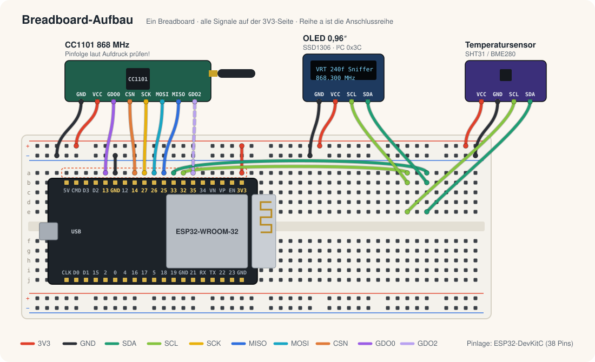
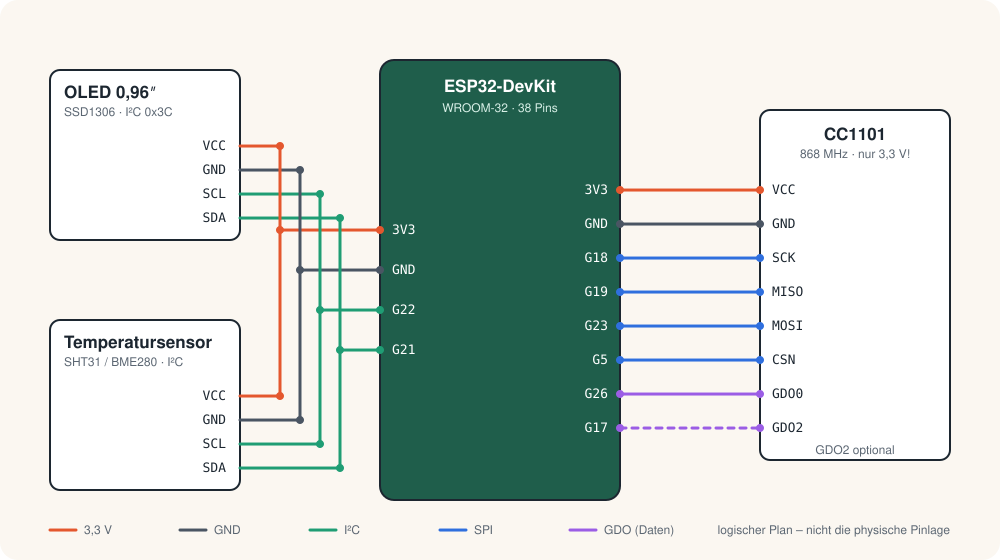

# Hardware-Aufbau

Schritt für Schritt vom Tütchen voller Module zum laufenden Sniffer auf dem Breadboard.

<picture>
  <source media="(prefers-color-scheme: dark)" srcset="assets/breadboard-dark.svg">
  
</picture>

## Stückliste

| Anzahl | Bauteil | Hinweis |
| --- | --- | --- |
| 1 | ESP32-DevKit (WROOM-32, 38 Pins) | Pinlage in der Grafik: DevKitC V4. Klone weichen ab, **Aufdruck auf der Platine gilt** |
| 1 | CC1101-Modul **868 MHz** mit Antenne | Pinfolge am Modul unterscheidet sich je nach Hersteller, Beschriftung prüfen |
| 1 | OLED 0,96″, SSD1306, I²C | Adresse 0x3C (auf der Platine oft „0x78“ = 8-Bit-Schreibweise) |
| 1 | Temperatursensor SHT31 oder BME280 | für Phase 4, kann jetzt schon mit auf den Bus |
| 2 | Breadboard (halb oder voll) | |
| ~20 | Dupont-Kabel (Stecker–Buchse und Stecker–Stecker) | |
| 1 | USB-Netzteil + Micro-USB-Kabel (Daten!) | reine Ladekabel können nicht flashen |

## Schaltplan

<picture>
  <source media="(prefers-color-scheme: dark)" srcset="assets/schaltplan-dark.svg">
  
</picture>

| Signal | ESP32 | CC1101 | OLED | Sensor |
| --- | --- | --- | --- | --- |
| 3,3 V | 3V3 | VCC | VCC | VCC / VIN |
| Masse | GND | GND | GND | GND |
| SPI-Takt | G18 | SCK | | |
| SPI MISO | G19 | MISO (SO) | | |
| SPI MOSI | G23 | MOSI (SI) | | |
| Chip-Select | G5 | CSN | | |
| Empfangsdaten | G26 | GDO0 | | |
| optional | G17 | GDO2 | | |
| I²C-Daten | G21 | | SDA | SDA |
| I²C-Takt | G22 | | SCL | SCL |

## Aufbau

1. **Breadboards nebeneinander:** Zwei Breadboards mit den langen Seiten aneinanderschieben. Das ESP32-DevKit ist so breit, dass auf einem einzelnen Board nur eine Lochreihe frei bliebe.
2. **ESP32 einsetzen:** quer über die Fuge, die eine Pinreihe in Reihe *j* des oberen Boards, die andere in Reihe *a* des unteren. USB zeigt zur Seite, damit das Kabel nicht stört.
3. **Versorgung:** 3V3 auf die +Schiene, GND auf die −Schiene legen. Die Schienen beider Boards am Rand miteinander verbinden.
4. **CC1101:** Mit Stecker–Buchse-Kabeln nach Tabelle verbinden. **VCC an 3V3, niemals an 5 V.** Antenne aufschrauben. Ohne Antenne ist die Reichweite minimal.
5. **OLED und Sensor:** Beide hängen parallel an SDA (G21) und SCL (G22). Die meisten Breakout-Boards haben die Pull-up-Widerstände schon drauf.
6. **Sichtprüfung:** Vor dem Einstecken des USB-Kabels jede Leitung einmal mit der Tabelle abgleichen. Vor allem VCC/GND und dass nichts am 5V-Pin hängt.

## Inbetriebnahme

```bash
cd firmware
pio run -t upload
pio device monitor
```

| Beobachtung | Bedeutung |
| --- | --- |
| `FEHLER: CC1101 antwortet nicht` | SPI-Verdrahtung (SCK/MISO/MOSI/CSN) oder Versorgung prüfen |
| OLED bleibt dunkel | SDA/SCL vertauscht oder falsche Adresse. Mit einem I²C-Scanner prüfen |
| RSSI-Balken springt ständig voll | Bandbreite zu groß oder Störquelle in der Nähe, `bw 135` probieren |
| `Pufferüberläufe` steigen | sehr viel Rauschen an GDO0, Bandbreite verkleinern |
| Keine Rahmen beim Drehen am Thermostat | Frequenz variieren (`f 868.25` … `f 868.40`), Thermostat näher heranlegen |

## Gehäuse

Kommt mit Phase 6 nach [`enclosure/`](../enclosure/): Sensorkammer unten, thermisch vom ESP32 getrennt, Aussparungen für OLED und USB.
