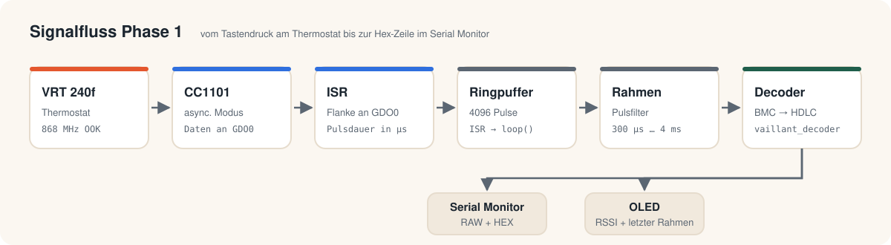
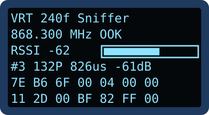

# Firmware

PlatformIO-Projekt in [`firmware/`](../firmware/). Aktuell: **Phase 1 – Sniffer**.

<picture>
  <source media="(prefers-color-scheme: dark)" srcset="assets/architektur-dark.svg">
  
</picture>

## Aufbau des Codes

```
firmware/
├── platformio.ini              Umgebungen: sniffer (ESP32), native (Tests)
├── include/config.h            Pins, Startfrequenz, Pulsfilter
├── src/main.cpp                Funk, ISR, Rahmenbildung, OLED, Serial-Befehle
├── lib/vaillant_decoder/       plattformunabhängiger Decoder
└── test/test_decoder/          Unity-Tests für den Decoder
```

### Empfang

Der CC1101 läuft im **asynchronen seriellen Modus** (`setCCMode(0)`): Er demoduliert OOK und gibt das Ergebnis direkt als Pegel an GDO0 aus, ohne eigene Paketlogik. So bleibt der Sniffer unabhängig von Datenrate und Rahmenformat, die beim VRT 240f ja noch unbekannt sind.

Eine Interrupt-Routine misst bei jeder Flanke die Dauer des vorherigen Pegels und legt sie in einen Ringpuffer (4096 Einträge). `loop()` holt die Pulse ab und gruppiert sie:

- Pulse **kürzer als 300 µs** gelten als Rauschen, **länger als 4 ms** als Pause. Beides beendet einen Rahmen.
- Nach **8 ms** ohne Flanke wird ein Rahmen ebenfalls abgeschlossen.
- Rahmen mit **weniger als 40 Pulsen** werden verworfen.

Alle Grenzen stehen in [`config.h`](../firmware/include/config.h).

### Dekodierung

[`vaillant_decoder`](../firmware/lib/vaillant_decoder/src/vaillant_decoder.h) arbeitet in Stufen, die einzeln aufrufbar sind:

| Stufe | Funktion | Was passiert |
| --- | --- | --- |
| 1 | `estimateUnit` | Grundpuls schätzen: Mittel aller Pulse unter dem 1,5-fachen des kürzesten |
| 2 | `pulsesToHalfBits` | jeden Puls in 1 oder 2 Halbbits zerlegen, Ausreißer zählen |
| 3 | `bmcDecode` | Differential Manchester: gleiche Halbbits → 0, verschiedene → 1 |
| 4 | `hdlcExtract` | Flag `0x7E` suchen, Bit-Stuffing entfernen, Bytes packen |

`decodeFrame` probiert beide möglichen Halbbit-Phasen und behält den längeren Rahmen. Findet sich kein `0x7E`, bleiben die Rohpulse trotzdem in der Ausgabe – genau die braucht man, wenn der 240f anders funkt als der 340f.

## Ausgabe

### Serial Monitor (115200 Baud)

```
# Rahmen 3 | 132 Pulse | Grundpuls 826 us | RSSI -61 dBm | Halbbit-Fehler 0
RAW: +1650 -825 +825 -1650 +1650 -1650 ...
HEX (Phase 0): 7E B6 6F 00 04 00 00 11 2D 00 BF 82 FF 00
```

`+` = Träger an, `-` = Träger aus, Werte in µs. *(Beispiel mit dem Rahmen aus dem 340f-Decoding, noch keine echte 240f-Messung.)*

### OLED



Zeile 1–2: Modus und Frequenz · Zeile 3: Live-RSSI mit Balken (−110 … −30 dBm) · Zeile 4: Nummer, Pulse, Grundpuls und RSSI des letzten Rahmens · Zeile 5–6: die ersten 14 Bytes.

## Serial-Befehle

| Befehl | Wirkung |
| --- | --- |
| `f <MHz>` | Empfangsfrequenz, z. B. `f 868.28` |
| `bw <kHz>` | Empfangsbandbreite 58 … 812, z. B. `bw 200` |
| `u <µs>` | Grundpuls fest vorgeben, `u 0` = automatisch |
| `raw on` / `raw off` | Rohpulse ein-/ausblenden |
| `status` | aktuelle Einstellungen, Rahmenzähler, Pufferüberläufe |
| `help` | Befehlsübersicht |

## Bauen und testen

```bash
cd firmware
pio run                 # ESP32-Firmware bauen
pio run -t upload       # flashen
pio test -e native      # Decoder-Tests auf dem Rechner
```

Die Tests erzeugen mit einem kleinen Encoder Pulsfolgen (inklusive ±120 µs Jitter und verschobener Bitphase) und prüfen, dass der Decoder die Bytes zurückgewinnt. Die GitHub-Action führt Build und Tests bei jedem Push aus.

## Bibliotheken

| Bibliothek | Zweck |
| --- | --- |
| [SmartRC-CC1101-Driver-Lib](https://github.com/LSatan/SmartRC-CC1101-Driver-Lib) | CC1101 ansteuern |
| [U8g2](https://github.com/olikraus/u8g2) | OLED |
| [Unity](https://github.com/ThrowTheSwitch/Unity) | Unit-Tests (über PlatformIO) |
